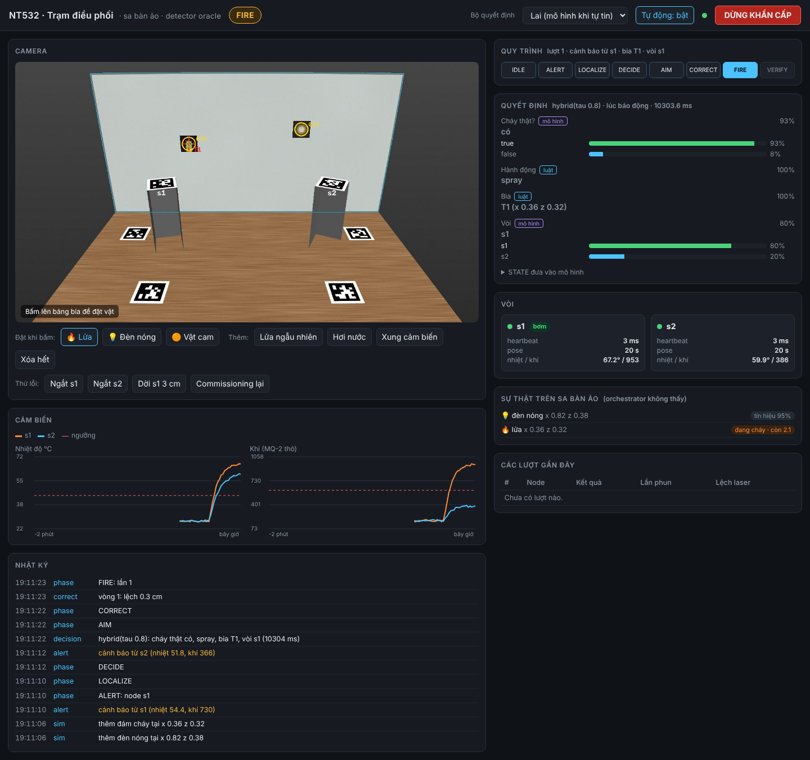

# Orchestrator, lớp nối mô hình và dashboard

Phần này nối các mảnh đã có thành một trạm chạy được: thị giác (YOLO và định vị), cảm biến (telemetry và cảnh báo qua CoAP), bộ quyết định (luật, mô hình Jev hoặc lai) và node chấp hành (pan–tilt, laser, bơm). Chạy được ngay trên sa bàn ảo; khi có phần cứng thì đổi camera và link, không đổi orchestrator.

```
uv run python scripts/run_station.py --source sim                    # mở http://localhost:8080/
uv run python scripts/run_station.py --source sim --decider hybrid   # mô hình ở VERIFY (--model-stages); cần runs/decider/jev/jev2 và --extra decider
uv run python scripts/run_station.py --source sim --decider hybrid --tau 0 --model-stages decide,verify --rule-questions nozzle --nozzle-both-tau 0.7   # mô hình mọi câu trừ nozzle (luật theo bia của mô hình)
uv run python scripts/run_station.py --decider rules                 # phần cứng: webcam + CoAP
```

## Luồng dữ liệu

```
 sensor H2 ──/t, /a──▶ CoapLink ─┬─▶ SensorHistory ─┐
                                  └─▶ Orchestrator ◀─┤
 webcam ──▶ FrameHub ──▶ Vision.targets ─▶ aggregate ┤
                                                     ▼
                                     fusion.decide_obs (cùng dạng bộ kịch bản)
                                                     ▼
                                     Decider: luật | Jev | lai  ──▶ Decision
                                                     ▼
                       chặn an toàn cứng (luật) ──▶ ENGAGE (ngắm + phun + bám tia + bám lửa + xác nhận, một pha)
                                                     │
                                       NodeLink: /aim /fire /stop /hb ◀─ /status
 Dashboard (HTTP) đọc Station.snapshot(), video MJPEG có vẽ, gửi lệnh
```

| Module | Việc |
| --- | --- |
| `nt532/net/protocol.py` | Payload hợp đồng CoAP mục 4 (key ngắn, dưới 60 byte), kiểm tra dạng, chống lặp `(n, s)` |
| `nt532/net/link.py` | `NodeLink`: cấp id lệnh, chờ `/status`, tuổi heartbeat; `HeartbeatSender` gửi `/hb` mỗi 500 ms |
| `nt532/net/discover.py` | Tìm địa chỉ node qua SRP server của OTBR (`ot-ctl srp server service`, chọn OMR trước mesh-local); `build_real` dùng, thiếu thì rơi về `network.nodes` |
| `nt532/net/coap.py` | `CoapLink` bằng aiocoap: server `/t`, `/a`, `/status`; client `/aim`, `/fire`, `/stop`, `/hb` |
| `nt532/orchestrator/fusion.py` | Gộp telemetry, phát hiện qua nhiều khung và sức khỏe vòi thành `obs` đúng dạng bộ kịch bản |
| `nt532/orchestrator/decide.py` | `RuleDecider`, `JevDecider`, `HybridDecider`, cùng trả `Decision` (đáp án, xác suất, nguồn) |
| `nt532/orchestrator/aiming.py` | Góc pan/tilt từ pose đế, giới hạn góc, offset tâm quay, bù tilt cho nước |
| `nt532/orchestrator/machine.py` | State machine mục 4 và các chặn an toàn |
| `nt532/orchestrator/frames.py` | Một luồng đọc camera, `fresh()` thay `read_fresh` |
| `nt532/sim/world.py` | Thế giới ảo thời gian thực: lửa, vật gây nhiễu, cảm biến, `SimLink`, `OracleDetector` |
| `nt532/station.py` | Lắp tất cả: `build_sim()`, `build_real()` |
| `nt532/dashboard/` | Dashboard web, chỉ dùng thư viện chuẩn |

## Một lượt xử lý

1. **ALERT:** node gửi `/a`; `CoapLink` chống lặp theo `(n, s)` rồi đưa vào hàng đợi. Cảnh báo xếp hàng quá 30 s thì bỏ.
2. **LOCALIZE:** lấy 4 khung (tối đa `localize_timeout_s` nếu chưa thấy gì), `vision.targets` từng khung, ghép thành từng bia theo vị trí (cách nhau dưới 5 cm là một bia), mỗi bia có conf theo từng khung (`None` khi mất).
3. **DECIDE:** dựng `obs` giống hệt bộ kịch bản: 5 mẫu cảm biến cuối của mỗi node, bia và khoảng cách tới từng node, tuổi heartbeat và pose, khả năng với tới tính từ pose đo được. Hỏi `real_fire`, `action`, `target`, `nozzle`.
   - `ignore`: về IDLE.
   - `alarm only` hoặc không chọn được bia: sang ALARM (node đã tự hú còi).
   - `spray`: qua bước chặn an toàn rồi ngắm.
4. **Chặn an toàn (luôn là luật):** chưa commissioning hoặc node bị dời, pose quá 60 s, mất heartbeat quá 1,5 s, mục tiêu ngoài bảng, góc ngoài giới hạn. Vòi được chọn bị chặn thì thử vòi còn lại, không được thì ALARM. Đáp án `both (s1 + s2)`: kiểm cả hai vòi, một vòi bị chặn thì ghi cảnh báo `safety` và phun như lượt một vòi bằng vòi kia, cả hai bị chặn thì ALARM.
5. **ENGAGE (một pha liên tục, thay AIM, CORRECT, FIRE, VERIFY):** ngắm góc ước lượng theo cal, chụp khung nền lúc laser tắt, rồi bật laser (node có bơm: bật cả bơm) và giữ tới hết lượt bằng cách gia hạn hẹn giờ mỗi chu kỳ (laser) hoặc khi còn dưới 30% (bơm); không tắt giữa chừng. Mỗi chu kỳ (`engage_hz`, 4 Hz):
   - **Bám lửa:** `vision.targets` trên khung mới, lấy hộp gần đích cũ nhất trong `engage_track_m` làm đích mới (EMA 0,5). Hộp này che vùng lửa khi tìm vết laser (chỉ với bia trên nền).
   - **Bám tia:** đo vết (lọc ổn định hai khung, che hộp lửa và chân trụ), e = đích - vết, Broyden, bước `engage_gain` x J^-1 e (kẹp `correct_step_max_deg`, giới hạn góc), gửi `/aim`. Không thấy vết thì giữ lệnh. Mỗi vết vẫn đi vào `_learn`.
   - **Theo dõi:** `on_target` khi lệch < `tolerance_m`, cộng dồn thời gian trúng; lưu chuỗi conf lửa gần đích và nhiệt từ cảm biến.
   - **Kết thúc:** `extinguished` khi không thấy lửa gần đích liên tục `engage_clear_s` và đã trúng >= `engage_min_hit_s`. `human` (pha HUMAN) khi trúng quá `engage_max_hit_s` mà lửa không yếu đi, cả pha quá `engage_timeout_s`, mất vết (hoặc mất lửa mà chưa trúng) liên tục quá `engage_lost_s`, hoặc bộ quyết định bảo bỏ. Dừng khẩn cấp hay lỗi link: như trước (`/stop`, FAULT).
   - **Bộ quyết định:** mỗi `engage_verify_s` dựng `verify_obs` (giữ nguyên dạng cũ; `attempt` tăng dần, `status` ok, nhiệt từ lúc bắt đầu, 3 conf cuối, `mark_cm` = độ lệch hiện tại) và hỏi `after_verify` ở luồng nền (không chặn việc gia hạn laser, nên Jev 8 s cũng không làm laser chớp). `done` chỉ kết thúc khi camera cũng không thấy lửa trong 3 khung cuối, nếu không thì bỏ qua; `re-aim` và `spray more` tiếp tục vòng; `call human` sang HUMAN. Luật và jev2 chạy như cũ, không cần train lại.
   - **Hai vòi:** chỉ vòi đầu bám tia (hai chấm không phân biệt được); vòi sau ngắm theo mô hình rồi bật cùng, không hiệu chỉnh (hạn chế).
   - **Hạn chế:** laser và bơm dùng chung một góc, chưa bù `water_tilt` như FIRE cũ. Overlay có `engage` = {state: aiming|on_target|lost, miss_cm, hit_s, clear_s}; sự kiện `engage` ghi khi đổi trạng thái và mỗi ~1 s. Các pha AIM, CORRECT, FIRE, VERIFY còn trong enum nhưng `_engage` không dùng; `_aim_and_correct` và `_final_aim` còn trong mã (test cũ).
   - Tham số: mục `targeting` của `config/site.yaml` (`engage_*`).
8. Mọi kết thúc (kể cả lỗi) đều gửi `/stop` tới mọi node. Lỗi mạng hoặc lỗi lạ thì sang FAULT.
   Id lệnh tăng dần trên mọi node, nên node nhớ id `/stop` lớn nhất đã nhận và từ chối (`rejected`, `err: stopped`) mọi `/aim`, `/fire` có id nhỏ hơn: gói gửi trước `/stop` mà tới sau (UDP đảo thứ tự, gửi lại) không được bật lại laser hay bơm. Firmware node phải giữ quy tắc này; `SimLink` cài đúng như vậy.
9. **Báo lại:** node chỉ gửi `/a` lúc chuyển sang báo động. Nếu lượt trước kết luận xong mà 3 mẫu mới nhất vẫn vượt ngưỡng sau 20 s, orchestrator tự xử lý lại. Tối đa 2 lần liên tiếp, sau đó ghi lỗi "cần người kiểm tra". Dừng khẩn cấp xóa mọi việc còn treo từ trước lúc dừng (cảnh báo trong hàng đợi, lượt xử lý lại), nên trạm không tự phun lại dù cảm biến còn nóng; chỉ cảnh báo mới từ node sau lúc dừng mới mở lượt mới.

## Bộ quyết định

| `--decider` | Hành vi |
| --- | --- |
| `rules` | Baseline luật của kế hoạch (`nt532.decider.rules`), không cần torch |
| `jev` | Mô hình Jev ở `runs/decider/jev/<--jev-run>`, cần `uv sync --extra decider` |
| `hybrid` | Từng câu hỏi: đáp án mô hình nếu độ tin cậy đã hiệu chỉnh ≥ `--tau`, ngược lại luật. Chỉ hỏi mô hình ở các giai đoạn trong `--model-stages` (mặc định `verify`; `decide` hoặc `decide,verify`); giai đoạn khác luật trả lời, không gọi mô hình. `--rule-questions` (vd `nozzle`) buộc các câu đó luôn lấy đáp án luật ở mọi giai đoạn, không phụ thuộc τ; lần gọi chỉ gồm các câu đó thì không gọi mô hình. Cùng ngữ nghĩa với `--rule-questions` của `eval_jev.py`; `--tau 0` nghĩa là câu còn lại luôn theo mô hình. Với `--rule-questions nozzle`, luật chọn vòi cho bia cuối cùng (bia mà câu `target` đã chọn sau khi lai), không phải bia của luật. `--nozzle-both-tau 0.7` nhận thêm `both` của mô hình khi độ tin cậy ≥ 0,7 và cả hai vòi khỏe, với tới được bia (xem decision-model.md). Mô hình lỗi thì dùng luật cả lượt và báo trên dashboard |
| `remote` | Gọi bộ quyết định ở máy khác (`--decider-url`, `--decider-timeout` mặc định 3 s). Máy kia chạy `scripts/serve_decider.py` với `jev`, `hybrid` hoặc `rules`. Quá hạn, mất mạng, HTTP lỗi hoặc trả lời sai dạng thì cả lượt dùng luật (`source` của đáp án là `rules-fallback`, tên bộ quyết định ghi "dự phòng") và dashboard báo "mô hình lỗi, đang dùng luật" như chế độ lai |

`--model-stages` chia câu hỏi theo giai đoạn: `after_verify` thuộc `verify`; `real_fire`, `action`, `target`, `nozzle` thuộc `decide`. Mặc định chỉ `verify` vì DECIDE cần nhanh (xem độ trễ dưới đây) còn luật yếu nhất đúng ở after_verify (62,8% so với 89,4% của Jev trên tập val). Tên bộ quyết định trên dashboard và `source` của từng đáp án (`rules`/`model`) cho biết giai đoạn nào đã dùng mô hình. `--decider jev` thuần mô hình luôn gọi ở cả hai giai đoạn.

Có thể đổi bộ quyết định ngay trên dashboard. `Decision` ghi cả đoạn STATE đã đưa vào mô hình, nên xem được trên dashboard và trong nhật ký.

Đo ngày 08/10 trên container 4 nhân x86, CPU, fp32, với `heads_only`: nạp mất khoảng 28 s, mỗi lần `decide()` mất khoảng **8,4 s**, vì mỗi lần quyết định phải mã hóa khoảng 9 chuỗi qua backbone 271M. Pi 5 có thể chậm hơn. Trước khi dùng Jev trên Pi cần đo lại; nếu quá chậm thì cân nhắc chạy bộ quyết định trên máy khác qua mạng, lượng tử hóa hoặc ONNX, hoặc chỉ hỏi mô hình ở bước VERIFY (nơi luật yếu nhất): đó là mặc định `--model-stages verify` của chế độ `hybrid`, nên DECIDE không phải chờ mô hình.

### Bộ quyết định ở máy khác (remote)

Jev mất cỡ 8 s mỗi lần trên CPU, nên có thể chạy trên laptop có GPU và để Pi gọi qua HTTP:

```
# laptop (cần uv sync --extra decider và runs/decider/jev/jev2)
uv run python scripts/serve_decider.py --decider hybrid --model-stages verify --device cuda --host 0.0.0.0 --port 8090
# Pi
uv run python scripts/run_station.py --decider remote --decider-url http://<ip laptop>:8090
```

Giao thức: `POST /decide` với `{"obs", "questions"}` (đúng dạng orchestrator đưa cho bộ quyết định) trả `Decision.to_json()`; `GET /health` trả `{"ok": true, ...}`. Máy chủ chỉ dùng thư viện chuẩn (`ThreadingHTTPServer`), giữ một thể hiện mô hình sau một khóa và in độ trễ mỗi yêu cầu. **Không mã hóa**; xác thực là tùy chọn (xem dưới). `--host` bắt buộc nêu rõ, chỉ bind vào mạng LAN tin cậy của phòng lab, không mở ra Internet. Máy chủ không phá được chặn an toàn vì các chặn cứng vẫn ở orchestrator trên Pi. Đặt `--decider-timeout` lớn hơn độ trễ mô hình đã đo (hoặc dùng `hybrid` với `--model-stages verify` để DECIDE vẫn do luật trả lời tức thì); `hybrid` ở máy chủ mà mô hình lỗi thì Pi vẫn nhận đáp án luật kèm cảnh báo lỗi trên dashboard.

**Token (tùy chọn).** Đặt `--token` cho `serve_decider.py` (hoặc env `NT532_DECIDER_TOKEN`) thì cả `POST /decide` lẫn `GET /health` đòi `Authorization: Bearer <token>`, thiếu hoặc sai trả 401. Pi gửi header này khi `RemoteDecider` có token, mặc định lấy từ env `NT532_DECIDER_TOKEN` trên Pi; token không bao giờ được ghi log. Token đi qua HTTP thường là rõ chữ, nên khi máy chủ nằm sau tunnel hoặc proxy phải dùng HTTPS.

**Đổi lúc đang chạy.** Dashboard chuyển Pi sang bộ quyết định ở xa không cần khởi động lại: `POST /api/cmd {"cmd":"decider","kind":"remote","url":"https://...","timeout":5}` (`timeout` giây, tùy chọn; thiếu `url` thì dùng `--decider-url` đã cấu hình, nếu cũng không có thì trả `{"ok": false, "error": ...}`). Chỉ nhận URL `http://` hoặc `https://`. Trạm ghi sự kiện `config` kèm tên máy chủ rồi tự nạp (warm-up) như khi khởi động.

## Tự hiệu chuẩn vòi

Ngắm dựa vào pose tag đế và vài số giả định: tâm quay `pivot_offset` (tâm tag tới tâm quay, hệ tag), hướng pan = 0, tilt = 0 nằm ngang, hệ số servo bằng 1. Không số nào được đo, mà tilt lệch 5 độ đã trượt bia 3 cm. Trạm tự học các số này từ vết laser camera thấy (`orchestrator/selfcal.py`), nên `pivot_offset` và `yaw_deg` trong `site.yaml` chỉ còn là giá trị ban đầu (prior). Vòi đứng trên trụ cao 30-40 cm, tag dán ở đế trụ thì pivot cỡ `[0.10, 0.0, 0.35]` và khác nhau từng node: đặt prior riêng ở `actuator.nodes.<n>.pivot_offset`.

**Học gì** (mỗi vòi, một `NodeCal`): `pivot` (hệ tag), `yaw0_deg` (pan = 0 lệch bao nhiêu so với hướng đầu của tag), `tilt0_deg` (độ cao của tia khi tilt lệnh bằng 0), `pan_gain`, `tilt_gain`. Mô hình: gốc tia là `tag.to_world(pivot)`, hướng ngang = yaw tag + `yaw0` + `pan_gain` x pan lệnh, độ cao = `tilt0` + `tilt_gain` x tilt lệnh. Servo lệch +3 độ thì `yaw0` ra +3 (lệnh được trừ đi 3 để bù). Mọi chỗ tính góc (`_aim_and_correct`, `_final_aim`, kiểm với tới, khoảng cách `dist3` đưa cho bộ quyết định) đều dùng cal này; giới hạn góc kiểm trên góc lệnh. Góc bù tia nước `water_tilt` vẫn cộng vào tilt hình học trước khi đổi sang lệnh.

**Khi nào**
- Quét lúc khởi động (`selfcal.startup_sweep`): một lần sau commissioning, lúc rảnh, mỗi vòi bắn laser tới `sweep_points` (8) góc trải đều pan và tilt, vết rơi trong vùng bia (cách mép 10 cm). Vòi lần lượt, mỗi lúc một laser. Sa bàn ảo mặc định không tự quét.
- Theo lệnh dashboard: `{"cmd": "calibrate", "node": "s1" | "s2" | "all"}`. Yêu cầu xếp hàng, chạy ở vòng chính khi trạm rảnh.
- Liên tục (`learn_from_correct`): mỗi vết laser của bước CORRECT thành một mẫu; cứ `refit_every` (4) mẫu mới thì khớp lại ở luồng nền trên 60 mẫu gần nhất. Kết quả chỉ áp dụng khi trạm rảnh (xong lượt đang chạy), để điểm ngắm đã bù giữa lượt không bị đổi.

Quét chỉ chạy lúc IDLE, orchestrator bật, vòi không bị chặn và còn heartbeat. Có cảnh báo tới giữa chừng, dừng khẩn cấp, hoặc lỗi liên lạc thì bỏ quét (vòi nhận `/stop`), cal cũ giữ nguyên.

**Khớp**: bình phương tối thiểu (Levenberg-Marquardt, Jacobian số, bỏ qua điểm ngoại lai bằng hàm Huber) trên khoảng cách 3D giữa vết dự đoán và vết đo. Mẫu ít (< `min_samples`) hoặc trải hẹp (pan < 15, tilt < 8 độ) thì chỉ khớp `yaw0`, `tilt0` và giữ pivot, hệ số servo như prior. Khi mẫu đủ trải, pivot chỉ bị prior yếu giữ (`pivot_prior_sigma_m`, 0,15 m) nên pivot sai 10-20 cm vẫn tìm lại được. Kết quả bị bác nếu rms sau khớp vượt `max_rms_cm` hoặc không tốt hơn trước, hoặc nếu cal vô lý (`selfcal.cal_violations`, lý do ghi vào `note` và sự kiện `calib`): tâm quay lệch số mồi quá `max_pivot_shift_m` (0,15), `pan_gain` hay `tilt_gain` ngoài [`min_gain`, `max_gain`] (0,7 và 1,3), `|tilt0|` hay `|yaw0|` quá `max_angle_offset_deg` (25). Mẫu hẹp có thể cho nghiệm rms thấp mà vô nghĩa (tâm quay cách mồi cả mét, hệ số servo gần 0); nếu để lọt, `sweep_commands` dùng chính cal hỏng để chọn góc quét nên hiệu chuẩn lại kẹt ("chỉ chọn được 0 góc"). Kiểm tra áp dụng cho cả quét lẫn học từ CORRECT. Sự kiện `calib` ghi từng phát (lệch so với dự đoán), rms trước và sau, và pivot thay đổi bao nhiêu cm so với prior.

**Lưu**: `calibration/nodes.yaml` (`selfcal.file`), `{node: {pivot, yaw0_deg, tilt0_deg, pan_gain, tilt_gain, n_samples, rms_cm, time}}`, nạp lại khi khởi động; cal nào vi phạm các giới hạn trên thì bị bỏ, dùng số mồi của site và có cảnh báo `calib` "bỏ cal đã lưu". Chọn góc quét (`sweep_commands`): ít hơn 3 góc theo cal hiện tại thì thử lại bằng số mồi của site, rồi nới lề `margin_m` về 0, rồi mới báo lỗi. Sa bàn ảo dùng `data/sim/nodes.yaml` và xóa file khi dựng trạm. `snapshot()["calib"]` có số hiện tại, `rms_cm`, `n_samples`, `fitted` và `state` (idle, sweeping, ok, failed). Tắt hết bằng `selfcal.enabled: false`.

**Giới hạn**
- Cần vết laser nằm trên mặt phẳng đã biết (bảng hoặc nền) và camera thấy; vết trên vật khác thì sai.
- Laser và vòi nước coi là cùng một tia: chênh lệch đầu laser với đầu vòi nước không tách được, phần quỹ đạo rơi vẫn do `water_tilt`.
- Pose tag sai một lượng nhất quán bị hấp thụ vào `pivot` và `yaw0` (đúng ý nghĩa vì đều tính trong hệ tag); đế vòi bị nghiêng ngoài mặt phẳng ngang thì chỉ được bù một phần qua `tilt0`.
- Servo phi tuyến hơn hệ số tuyến tính cần bảng hiệu chỉnh riêng.
- `calibration/nodes.yaml` là số riêng của từng bộ phần cứng, `.gitignore` chưa loại nó.

## CORRECT: visual servoing và laser sáng liên tục

Cách cũ dời điểm ngắm 3D đúng bằng độ lệch đo được rồi đổi sang góc bằng cal, tức giả định mô hình góc đúng. Cal sai nặng (hiệu chuẩn bị bác, hệ số servo thật 0,4 so với 1,0) thì chấm chỉ nhích một phần nhỏ mỗi vòng (trên trạm thật: lệch 22,4, 16,4, 14,0 cm rồi hết 3 vòng).

CORRECT hiện là điều khiển vòng kín trong không gian lệnh (`_aim_and_correct`):

- Biến điều khiển là góc lệnh `c = (pan, tilt)`; phép đo là vết laser `s` trên mặt của bia, lấy hai thành phần theo `_plane_mask` (sàn: x, y; bảng: x, z); sai lệch `e = bia - s`.
- Jacobian `J = ds/dc` (2x2, mét trên độ) khởi tạo bằng sai phân trung tâm (bước 1 độ) của mô hình tiến theo cal hiện tại (`selfcal.forward_spot`, giao tia với mặt phẳng vô hạn để hàm trơn). Không tính được (tia không chạm mặt) thì lấy quanh lệnh hướng vào bia; vẫn không được thì đo thật bằng hai bước dò `correct_probe_deg`.
- Sau mỗi lần đo cập nhật Broyden: `J += ((ds - J dc) dc^T) / |dc|^2`, bỏ qua khi `|dc|` dưới 0,02 độ. J nhờ vậy học ngay hệ số servo và hướng thật của node.
- Bước `dc = J^-1 e`, kẹp độ lớn `correct_step_max_deg` (20; cal sai nặng cần bước lớn, vd hệ số 0,4 cần lệnh gấp 2,5 lần) rồi kẹp trong `aiming.limits`. J gần suy biến (điều kiện > 1000) thì dùng bước theo mô hình (cách cũ). Kẹt ở giới hạn góc (bước dưới 0,02 độ) thì dừng.
- Vết lệch dự đoán `s_trước + J dc` hơn 3 lần quãng dự đoán và hơn 15 cm thì đo lại một lần trước khi tin (video lửa chập chờn làm kênh đỏ đổi giữa các khung).
- Dừng khi lệch 3D dưới `correct_done_m` (0,01) hoặc hết `correct_max_iters` (6). Vòng cuối tệ hơn vòng tốt nhất thì quay về lệnh của vòng tốt nhất.
- Mỗi lần đo vẫn gọi `_learn` (selfcal học tiếp), ghi `run.shots`, sự kiện `correct`, overlay `spots`; overlay `aims` là điểm mà mô hình tin lệnh cuối rơi vào.
- `_aim_and_correct` trả `(điểm ngắm hiệu dụng, độ lệch cuối cm, (pan, tilt) đang giữ laser)`; `_final_aim` dùng đúng góc đó (cộng phần bù tia nước nếu vòi có bơm; bù là độ hình học nên chia cho `tilt_gain` khi đổi sang lệnh), nên FIRE không quay thêm và laser không giật. Vòi không bơm không bù tia nước vì laser không rơi theo quỹ đạo.

Laser sáng liên tục: khung nền chụp một lần lúc laser TẮT, trước khi bật; sau đó bật một lần và mỗi vòng chỉ gia hạn hẹn giờ (`Settings.laser_hold_ms`, 4000 ms mỗi lần, nên nếu Pi chết giữa chừng laser vẫn tự tắt): ngắm (laser vẫn sáng khi servo quay), chờ `reached` cộng `Settings.laser_settle_s` (0,3 s), chụp khung mới, tìm vết bằng hiệu với khung nền. Vùng tìm giới hạn trong bán kính `correct_search_m` (0,15 m; vòng đầu gấp đôi) quanh chỗ J dự đoán (`Vision.find_spot(near=..., near_m=...)`), nới 2 rồi 4 lần nếu không thấy, vẫn che đầu phát như trước. Dừng khẩn cấp và FAULT vẫn gọi `link.stop`, tắt laser ngay.

`IntegratedLink`: khi một lệnh `fire laser` mới thay lệnh cũ thì luồng của lệnh cũ không gửi OFF (trước đây gửi, làm laser chớp giữa hai lần ngắm); `_aim` và `_track` không đụng tới laser. `SimLink` cũng vậy.

Hạn chế đã biết:

- Hai vòi (`both`): CORRECT lần lượt, nên laser vòi trước phải tắt (lệnh laser 1 ms, không dừng servo) trước khi CORRECT vòi sau, nếu không hai chấm lẫn nhau. Hệ quả: giữa CORRECT và FIRE laser của vòi trước tắt một lúc; FIRE bật lại cả hai.
- Vết rơi lên vật cao hơn sàn bị định vị sai (`find_spot` coi vết nằm trên mặt phẳng của bia), J học theo vết sai đó; đo lại và quay về vòng tốt nhất chỉ giảm nhẹ.
- Tìm vết quanh chỗ dự đoán: nếu J dự đoán sai quá bán kính nới tối đa (4 lần) thì không thấy vết và CORRECT dừng với lệnh đang giữ.
- `sim_demo.py` dùng vòng `sim.loop.correct` giản lược (dời điểm ngắm), không phải orchestrator; chỉ nhận `correct_max_iters` từ site.yaml.

## Dashboard



- **Camera:** video có vẽ viền bảng, bia (vòng vàng và conf), bia được chọn (dấu đỏ), điểm ngắm (chữ thập nghiêng trắng) và vết laser đo được (vòng xanh) của từng vòi, mỗi dấu ghi tên vòi bên cạnh để lượt hai vòi vẫn phân biệt được. Trên sa bàn ảo, bấm lên bảng để đặt lửa, lửa lớn (🔥 Lửa lớn, để thử phun hai vòi), đèn nóng hoặc vật cam.
- **Quy trình:** bước hiện tại của state machine, lượt, bia, vòi.
- **Quyết định:** từng câu hỏi, đáp án, độ tin cậy, nguồn (luật hoặc mô hình), thanh xác suất, đoạn STATE.
- **Vòi:** tuổi heartbeat và pose, lý do bị chặn, và thẻ "đang ngắm" (pha AIM, CORRECT) hoặc "đang phun" (pha FIRE) cho vòi nào đang được orchestrator làm việc, lấy từ `overlay.active` nên có cả trên phần cứng thật; trên sa bàn ảo còn có trạng thái laser và bơm.
- **Sự thật trên sa bàn ảo:** lửa còn cháy hay đã tắt (lửa lớn ghi rõ), vật gây nhiễu. Orchestrator không thấy phần này, dùng để so với quyết định.
- **Cảm biến** 2 phút gần nhất kèm ngưỡng, **nhật ký**, **các lượt gần đây** (có cột Vòi: `s1`, `s2` hoặc "cả hai").
- **Nút:** dừng khẩn cấp, tắt chế độ tự động, commissioning lại, đổi bộ quyết định. Trên sa bàn ảo còn có hơi nước, xung cảm biến, ngắt liên lạc từng node, dời node.

API cho script khác: `GET /api/state`, `GET /api/events?since=N`, `GET /snapshot.jpg`, `GET /stream.mjpg`, `POST /api/cmd` với `{"cmd": "stop" | "enable" | "recommission" | "decider" | "fire" | "fire_large" | "lamp" | "object" | "steam" | "spike" | "clear" | "online" | "move_node", ...}` (`fire` nhận thêm `"size": "small" | "large"`, giá trị khác bị từ chối). Không có xác thực, chỉ mở trong LAN của sa bàn.

`orch.overlay` trong `/api/state` (và `Orchestrator.snapshot()["overlay"]`) gồm `tracks`, `target`, `nozzle`, cùng ba trường theo vòi: `active` (danh sách vòi đang được ngắm hoặc phun, rỗng lúc VERIFY và hết lượt), `aims` và `spots` (`{vòi: {"x", "z"}}`: điểm ngắm đã bù và vết laser đo được của từng vòi). Cầu nối MQTT cũng suy ra bơm và laser của từng node từ `active`.

### Đẩy lên control trên homelab

Server giám sát/điều khiển (`homelab/control`) chạy ở mạng khác, trên một domain public (cloudflared trên VM); server không gọi vào Pi. Pi tự làm HTTP client: mỗi chu kỳ (mặc định 1 s) `POST <url>/api/pi/push` với `Authorization: Bearer <token>`, body gồm `boot` (chuỗi ngẫu nhiên mỗi tiến trình), `state` (như `/api/state`), `events` (từ `ack` trở đi) và `results` (kết quả lệnh đã chạy). Response `{"ack", "cmds"}`: Pi chạy từng lệnh bằng cùng hàm của `POST /api/cmd`, rồi đẩy lại ngay để kết quả về nhanh. Mất mạng thì giữ kết quả, thử lại lùi dần 1, 2, 4... tối đa 10 s; sai token (401) báo lỗi trong log. Dashboard LAN không đổi. Mã: `pi/src/nt532/dashboard/push.py`.

```
export NT532_PI_TOKEN=<token>   # hoặc --control-token
uv run --no-sync python scripts/run_station.py --source sim --control-url https://<domain> --control-token <token>
```

## Sa bàn ảo

`SimWorld` chạy theo thời gian thực. Mọi số liệu dưới đây là **giả định để demo**, không phải số đo:
- **Cảm biến:** mỗi nguồn kéo nhiệt, khí, ẩm của từng node lên theo `e^(-khoảng cách/0,35 m)` với hằng số thời gian vài giây. Node lấy mẫu 1 Hz, báo động khi 3 mẫu liên tiếp vượt ngưỡng, hủy khi 5 mẫu dưới ngưỡng.
- **Lửa:** cần khoảng 0,8 đến 2,6 "giây phun trúng" (nước rơi trong 3,5 cm quanh tâm) mới tắt. Tắt rồi thì thẻ đổi sang thẻ cháy sém. `SimWorld.ignite(size="large")` tạo lửa lớn: thẻ to gấp 1,8, đỉnh tín hiệu ×1,5, suy giảm theo khoảng cách chậm gấp đôi (với tới cả hai node) và cần 1,6 đến 5,2 giây phun trúng, để thử phun hai vòi. Nước được ghi theo thời gian thật đã trôi giữa hai lần ghi (tối đa 0,5 s mỗi lần, và không quá thời gian lệnh bơm), không phải 0,1 s cố định mỗi vòng lặp, nên vòng lặp bị kẹt lúc `world.lock` bận dựng khung hình không làm lửa nhận ít nước hơn thời gian bơm.
- **Servo:** mỗi node lệch ngẫu nhiên tới 3° để vòng CORRECT có việc. `/aim` mất 0,15 s cộng thời gian quay (150°/s).
- **Detector:** khi chưa có `models/fire-n.pt` và thẻ in từ D-Fire, dùng `OracleDetector`. Detector này đọc thẻ thật trong scene và cho conf theo loại: lửa 0,55 đến 0,92, đèn 0,2 đến 0,6, vật cam 0,08 đến 0,45, thẻ đã tắt gần 0. Mỗi khung có 10% bỏ sót. Có trọng số thì dùng `--detector yolo`; thẻ tổng hợp (`data/sim/cards_synth/`) chưa được YOLO học nên nên dùng thẻ D-Fire.

Trên sa bàn ảo, luật để lộ đúng hai điểm yếu đã đo ở `docs/decision-model.md`: phun vào đèn nóng nằm gần sensor báo động, và kết luận `done` khi trúng mà lửa vẫn cháy (khung "sự thật" cho thấy lửa còn cháy).

### Node giả chạy firmware node B tích hợp (`--link coap-integrated`)

`uv run python scripts/run_station.py --source sim --link coap-integrated` thay mỗi node ảo bằng `IntegratedFakeNode` (`nt532/net/integrated_node.py`): server CoAP trên UDP localhost chạy **lõi C thật** của `firmware/node-b-integrated/main` (`integrated_control.c`, `probe_state.c`) qua ctypes, nói đúng hợp đồng của Hậu (`/info /status /hb /stop /pantilt /laser`, payload text `ARM`, `HOME`, `pan_us,tilt_us`, `ON`, `OFF`; ramp 20 µs mỗi 20 ms; hết heartbeat 1500 ms thì tắt PWM, relay và xóa ARM). Phía Pi, `IntegratedLink` (`nt532/net/integrated_link.py`, kế thừa `CoapLink`) dịch hợp đồng cũ của orchestrator sang hợp đồng mới:

| Orchestrator (cũ) | Adapter gửi (mới) |
|---|---|
| `heartbeat` | `POST /hb` rỗng (NON), có trả lời thì tính là node còn sống |
| `aim(pan, tilt)` độ | đổi sang µs bằng `PulseMap`; `ARM` nếu chưa armed, `HOME` nếu chưa có PWM (đợi `GET /pantilt` báo `pwm_active`, tối đa 1 s), rồi `pan_us,tilt_us`. Báo `accepted`, sau đó poll `GET /pantilt` mỗi 50 ms tới khi xung bằng đích thì báo `reached`; quá `ttl` thì `fault` (`timeout`). 4.03 là `rejected` (`forbidden`, ví dụ chưa có heartbeat), 4.00 là `rejected` (`bad_request`), ngoài biên µs là `rejected` (`out_of_range`, không gửi gì) |
| `fire(laser, ms)` | `POST /laser ON`, sau `ms` thì `OFF`, báo `done` |
| `fire(pump, ms)` | **bị từ chối ngay** (`rejected`, `no_pump`), không gửi gì: firmware của Hậu không có bơm và relay chỉ mô phỏng laser |
| `stop` | `POST /stop` |
| `info` | `GET /info`; giới hạn góc suy ra từ `PulseMap` (`hb` 1500, `fire` 0) |

Hệ quả: `IntegratedLink.has_pump = False`, nên orchestrator không gửi lệnh bơm nào; FIRE giữ laser sáng tại lệnh cuối (laser thay tia nước), `status` là `ok` khi laser báo `done`, và kết luận `extinguished` do VERIFY (cảm biến, camera) quyết định như thường. `fire(pump)` tới link này vẫn bị từ chối như trên. Khi một lệnh `fire laser` mới thay lệnh cũ (CORRECT gia hạn mỗi vòng, rồi FIRE), luồng của lệnh cũ không gửi OFF mà nhường cho lệnh mới; chỉ lệnh hiện hành hết giờ hoặc `/stop` mới tắt laser, nên laser không chớp giữa các vòng ngắm.

- **`PulseMap` là TẠM THỜI.** Ánh xạ tuyến tính `deg_per_us = 0.09` (180° trên 2000 µs), HOME 1500 µs ứng với 0°, dấu `+1` cả hai trục. Chưa có số đo góc–xung thật (bàn giao 13/11 mục E), phải thay bằng bảng đo trước khi dùng trên board.
- **Telemetry là lớp sim-only.** Firmware của Hậu không đẩy `/t` hay `/a` lên Pi (DHT11 chỉ có trong `GET /status`). Node giả tự đọc cảm biến của sa bàn, POST `/t` mỗi `telemetry_s` và `/a` theo luật 3 mẫu vượt, 5 mẫu dưới ngưỡng để orchestrator có cảnh báo; phần này không có trong firmware. Trên phần cứng thật cần node cảm biến riêng hoặc firmware bổ sung.
- **Build lõi C.** Linux: `make -C firmware/node-b-integrated/test libintegrated.so` (tự chạy khi nạp nếu file thiếu hoặc cũ). Windows chỉ nạp `integrated.dll` có sẵn, build bằng mingw (ví dụ trong Docker): `make -C firmware/node-b-integrated/test integrated.dll`. Thiếu thư viện thì test `test_integrated_node.py` và `test_station_integrated.py` tự bỏ qua.

## Việc còn mở, cần chốt với Hậu và Hiếu

- **Telemetry cho mô hình:** `obs` dùng 5 mẫu cuối mỗi node (giống bộ kịch bản, 1 Hz), nên firmware gửi `/t` mỗi 1 s (`NT532_TELEMETRY_S`, khoảng 55 byte/s mỗi node trên Thread). Gửi thưa hơn thì 5 mẫu trải dài hơn lúc train.
- **Heartbeat:** `hb_ms` là thời gian từ lần cuối Pi nghe thấy node (bất kỳ bản tin nào, ACK của lệnh CON, hoặc trả lời `/hb`). `/hb` gửi NON để không bị gửi lại, nhưng node phải trả 2.04 cho mỗi `/hb`: `CoapLink` chờ trả lời đó tối đa 1 s và coi là node còn sống. Không trả lời thì `hb_ms` chỉ được làm mới bởi `/t` (5–10 s) và vòi luôn bị chặn vì quá 1,5 s.
- **`/status` không có tên node:** Pi suy ra từ địa chỉ nguồn (`network.nodes`). Thêm key `n` (đã hỗ trợ, tùy chọn) thì chắc hơn.
- **Laser:** dùng `/fire` với `dev=laser` và `ms`, cùng điều kiện "aim cùng id đã reached" như bơm.
- **Vết nước:** chưa có hàm đo vết nước thật; `water_mark` trong VERIFY đang lấy độ lệch laser đo được ở vòng CORRECT cuối.
- **Giới hạn góc, offset tâm quay, bù tilt cho nước, ngưỡng cảm biến:** còn là giả định trong `config/site.yaml` (`actuator`, `sensors`).
- **Ngưỡng YOLO:** `Vision.detect` lọc ở `detect_conf` 0,35, trong khi bộ kịch bản còn giữ phát hiện yếu tới 0,15. Mô hình có thể thấy ít phát hiện yếu hơn lúc train.
